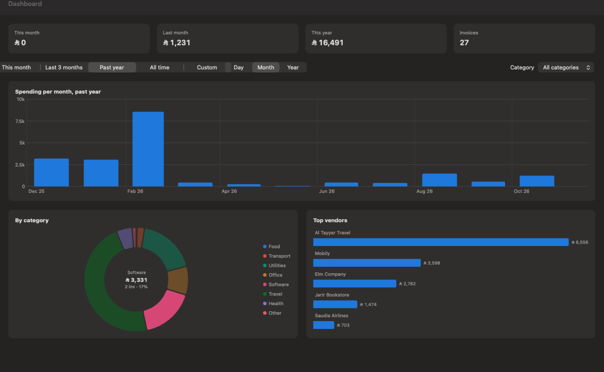
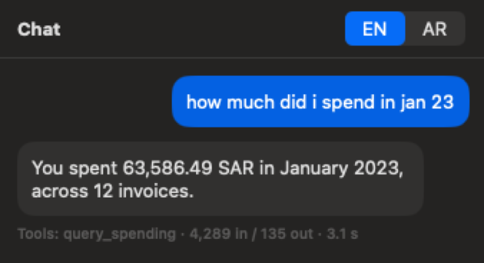
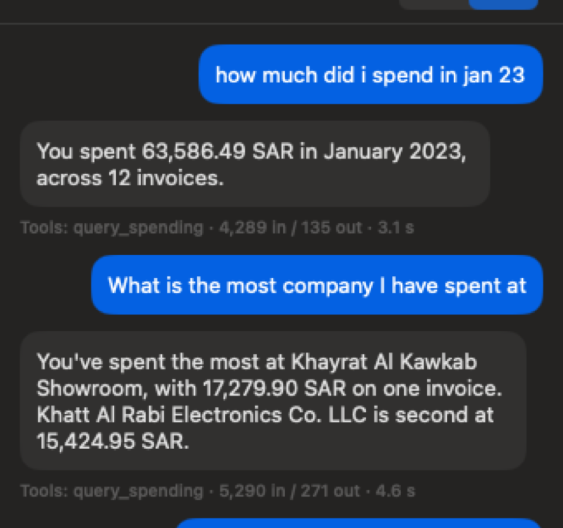

# Expenses: project report

Expenses is a native macOS app that reads invoices, stores them as expenses, draws the graphs, and lets the user ask questions and control the app by typing or speaking. It was built on 17 November 2026 with Claude Code, working from a written specification (`CLAUDE.md`).

## 1. Brief and what was delivered

| What was asked | What was delivered |
|---|---|
| A Mac app called Expenses | Native macOS app written in SwiftUI |
| Upload invoices | Import of PDFs and images; the fields are extracted and checked automatically |
| Invoices added to the RAG | Every invoice is indexed on import and searchable from the chat |
| Ask AI about expenses by month, day and so on | Chat answers by day, month, year, category or vendor |
| Graphs | Dashboard with spending over time, by category and by vendor |
| Full control by chatting | Chat adds, edits and deletes expenses and changes the graphs and screens |
| Voice | Dictation in English and Arabic, sent through the same chat |
| A PDF of what was done, how, and the frameworks | This report |

Three things were added beyond the brief because they make the app trustworthy: automatic checks on every extracted invoice, duplicate detection, and a built-in evaluation screen that measures extraction accuracy.

<figure>

<figcaption>Figure 1. The dashboard: totals, spending per month for the past year, spending by category, top vendors.</figcaption>
</figure>

## 2. How it works

**In one sentence.** An invoice goes in, Claude reads it, the app checks the result and saves it, and the chat answers questions by calling a small set of tools that read or change the saved data.

**Importing an invoice.** If a PDF contains text, the text is sent to Claude; scans and photos are sent as images. Claude must reply through a fixed form (a tool with a strict schema), so the app always receives the same twelve fields. The app then checks that subtotal plus VAT equals the total, that VAT is about 15%, and that the date is sensible. If a check fails, Claude is shown the failure and re-reads the invoice once. If it still fails, the expense is saved with a "Needs review" badge so nothing wrong passes silently.

**Numbers never come from the model.** Every total on the dashboard or in the chat is calculated by the database layer (`ExpenseStore`). Language models are unreliable at arithmetic, so the model only decides which calculation to request and then words the answer.

**RAG.** The text of each invoice is split into passages of about 500 characters and embedded on the Mac. When a question is about what an invoice contains, such as "What did I buy from Nahdi Pharmacy?", the closest passages are retrieved and given to Claude. Retrieval is used for content questions only, and never for totals.

**Chat and control.** The chat gives Claude eight tools: query spending, list expenses, search invoices, add, update and delete an expense, show a chart, and open a screen. Claude chooses the tools, the app runs them and returns the results, and this repeats for at most six steps until Claude answers. Because the chart and screen tools change the same state the interface observes, "show me last year by month" updates the dashboard immediately. A delete is never carried out by the model: the chat shows Delete and Cancel buttons and waits for a click.

<figure class="half">

<figcaption>Figure 2. Chat answers, each showing the tool used, the tokens and the time taken. The EN/AR switch sets the dictation language.</figcaption>
</figure>

**Voice.** The microphone button transcribes speech live into the message field using Apple's speech recognition. On stop, the text is sent through exactly the same path as a typed message, so anything that can be typed can be spoken.

<figure class="half">

<figcaption>Figure 3. Dictating in Arabic, with the live transcript filling the message field.</figcaption>
</figure>

## 3. Frameworks

No third-party packages were used. Everything except the language model is an Apple framework that ships with macOS.

| Framework | Used for | Why |
|---|---|---|
| SwiftUI | The whole interface | Native Mac app; the screen updates itself when the chat changes the app's state |
| SwiftData | Storing expenses and invoice passages | Built-in database with live updates to the interface |
| Swift Charts | The three graphs | Native charts with date axes and hover details |
| PDFKit | Reading text from PDFs | Exact and free, so images are sent only when needed |
| NaturalLanguage | Embeddings for RAG | Runs on the Mac, so search data never leaves it |
| Speech and AVFoundation | Dictation | On-device recognition where the language supports it |
| Keychain | The API key | The key is never stored in code or in plain files |
| Claude API | Reading invoices and running the chat | Called directly over HTTPS from one small client file |

Two Claude models are used: `claude-haiku-5-5` for extraction, because it is fast and inexpensive, and `claude-sonnet-5-5` for the chat, because it plans tool use better.

**What is sent to Claude.** For extraction, only the invoice being imported. For chat, the conversation and the results of the tools it called, which contain only the rows or totals the question needed. The database is never sent whole, and embeddings are computed on the Mac.

## 4. How it was built

The app was built with Claude Code in five phases. Each phase had its own prompt with a goal, a numbered build list and a "done when" test, and the conversation was cleared between phases to keep token use low.

1. Invoices in, expenses out: data model, API client, extraction, invoices table.
2. Dashboard: totals and three charts.
3. Chat and control: RAG, tools and the tool loop.
4. Voice: speech service and language switch.
5. Release: build, documentation and this report.

A fixed set of rules in `CLAUDE.md` kept the code consistent across phases: numbers only from the database layer, no third-party packages, every file under 200 lines, and a clean build before a phase could end. The result is about 2,900 lines of Swift in 36 files.

## 5. Testing

After each phase the app was tested by hand: importing the 15 sample invoices and checking the values against the PDFs, comparing dashboard totals with queries run directly on the database, asking the chat to answer, add, edit and delete, and dictating commands in English and Arabic.

Extraction accuracy was also measured in the app's Evaluation screen on 20 synthetic Saudi receipts in Arabic and English (Bayanat Labs dataset, CC BY 4.0): 99.3% field accuracy, with vendor, VAT number, date and all amounts read correctly every time. The evaluation screen exists to confirm that the model is working, which it is; the exported results are in `tools/evaluation.md`.

## 6. Limitations

- **No local model.** The intention was to run an open-source model on the Mac for data sovereignty. The development machine has 8 GB of RAM, which is not enough for a model that reads invoices reliably, so Claude is used for extraction and chat while search and dictation stay on the device. The model is reached through a single file (`ClaudeClient`), which is the only part to replace.
- **Needs internet** for importing and chatting. Saved data can still be browsed offline.
- **Arabic search is by keyword.** Apple's on-device embeddings are English-only.
- **Single user and single currency.** There are no accounts or sync, and totals assume SAR.
- **Not notarised.** The first launch has to be approved in System Settings.
- **Tested on synthetic data**, not on photographs of real receipts.

## 7. Next steps

1. Data sovereignty: add a setting to send extraction and chat to a self-hosted or in-Kingdom model.
2. Arabic semantic search: multilingual embeddings in place of the English-only ones.
3. Evaluation: add real receipts.
4. Real-time voice and multiple users: streamed answers, accounts and sync.

The source code, the specification (`CLAUDE.md`), the setup guide (`README.md`) and the exported evaluation (`tools/evaluation.md`) are in the GitHub repository.
